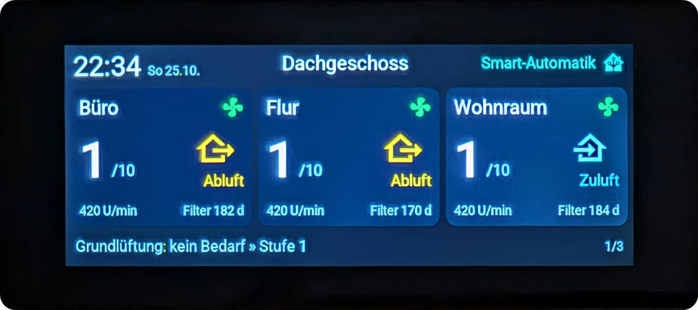
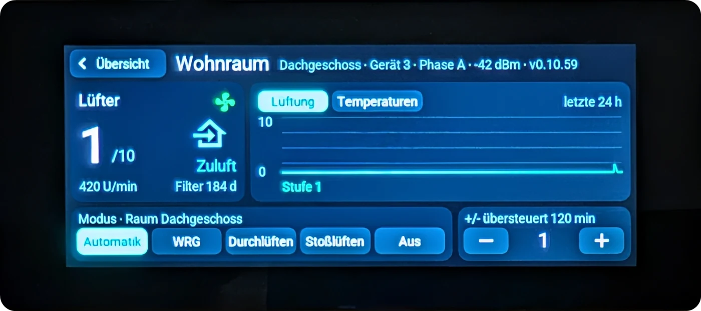
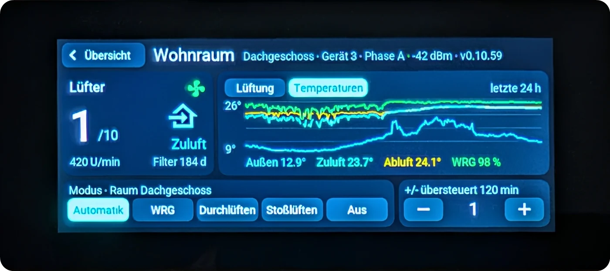
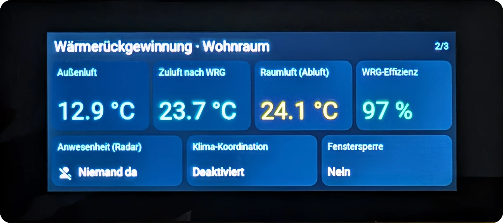
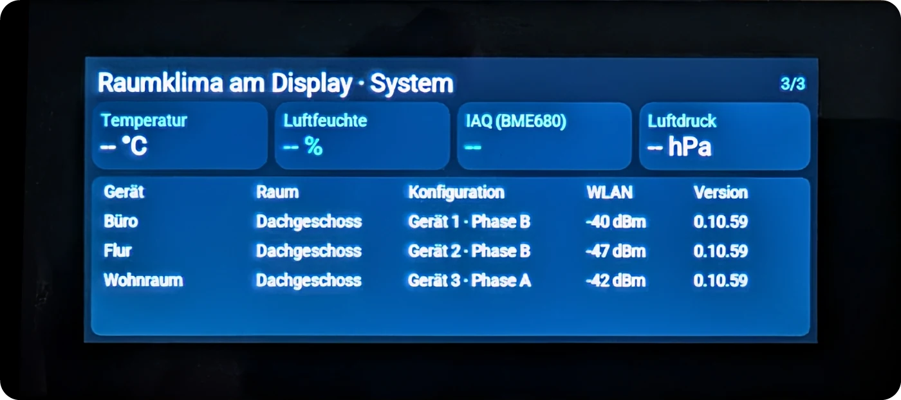
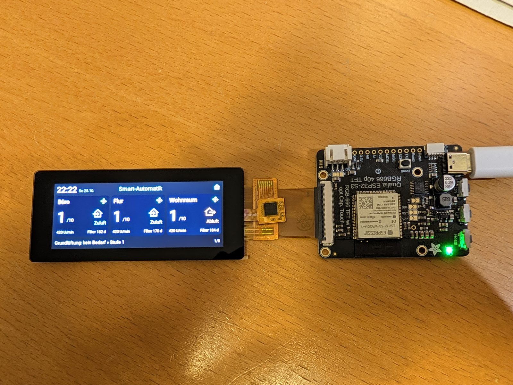
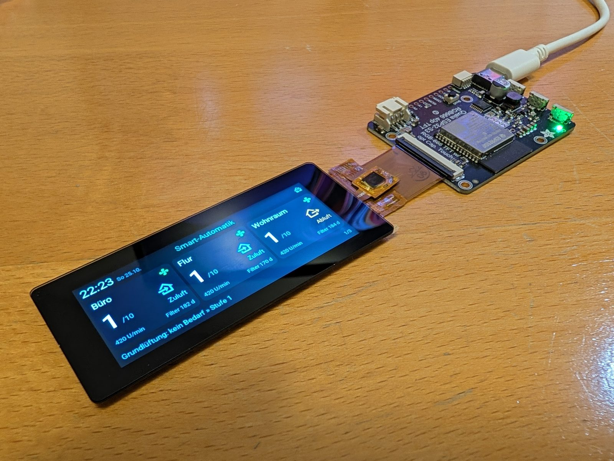
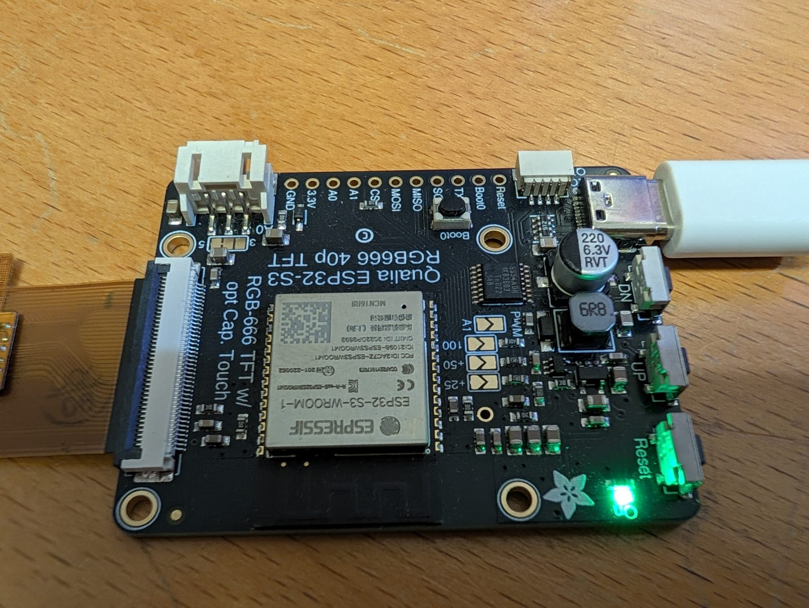
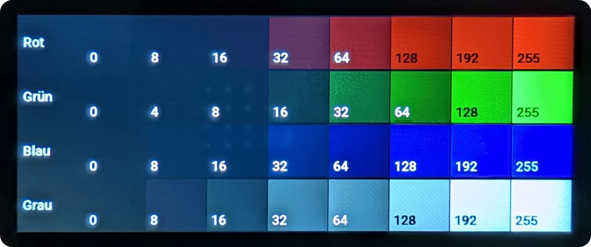

# ESPHome-WRG-Display-Dashboard

Ein auf ESPHome, LVGL und dem **Adafruit Qualia ESP32-S3 for TTL RGB-666 Displays** basierendes Bar-Display-Dashboard für die Steuerung und Überwachung meiner Wohnraumlüftung (WRG).
Es wird das coole Bar Display (TL032FWV01CT-I1440A) mit einer Auflösung von 320 x 820 Pixel und Touch-Funktion verwendet.
Ich habe sonst keine OpenSource Projekte finden können, welche dieses Display & Controller unter ESPHome nutzen, daher hoffe ich, dass dieses Projekt anderen als Inspiration dienen kann.



---

## 📖 Projektbeschreibung

Dieses Projekt stellt ein Touch-Dashboard zur Verfügung, welches lokal Sensordaten (BME680) erfasst und die vernetzten Lüftungsgeräte meines [VentoSync](https://github.com/thomasengeroff-dotcom/ESPHome-Wohnraumlueftung)-Projekts ("ESPHome-Wohnraumlueftung") über Home Assistant übersichtlich anzeigt.
Die Benutzeroberfläche wurde mit **LVGL (Light and Versatile Graphics Library)** deklarativ in YAML umgesetzt und läuft im Querformat auf dem "Rectangle Bar" Display.
Über die Detailseite eines Geräts lassen sich Betriebsmodus und Lüfterstufe des Raums direkt am Display ändern. Der Ordner `ui/` enthält einen ersten, noch nicht eingebundenen Entwurf aus EEZ Studio.

## ✨ Features

- **LVGL-Dashboard im Querformat (820 x 320)** für [VentoSync](https://github.com/thomasengeroff-dotcom/ESPHome-Wohnraumlueftung)-Geräte (Tippen auf den Hintergrund wechselt die Seite, nach 60 s ohne Berührung zurück zur Übersicht):
  - **Übersicht pro Raum**: Uhrzeit, Raumname, Modus und Smart-Automatik-Status des Raums (vom jeweiligen Master) sowie je eine Karte pro Lüftungsgerät des Raums (online/aus, Lüfterstufe, Richtung Zuluft/Abluft, Drehzahl, Filter-Betriebstage bzw. Filterwechsel-Alarm). Pro Seite passen drei Geräte; hat ein Raum mehr, bekommt er weitere Seiten („Dachgeschoss 1/2"). Tippen auf den Hintergrund blättert durch alle Raumseiten, danach folgen Wärmerückgewinnung und System. **Tippen auf eine Karte öffnet die Detailseite des Geräts.**
  - **Detailseite**: aktuelle Werte des Geräts (Gerät/Phase, WLAN, Firmware), ein **24-h-Verlauf** wie im VentoSync-Web-Dashboard (Reiter *Lüftung*: Stufe, Bedarf, CO2; Reiter *Temperaturen*: Außenluft, Zuluft nach WRG, Abluft, WRG-Wirkungsgrad, nur bei Geräten mit NTCs) und die **Bedienung**:
    - **Modus** (Automatik, WRG, Durchlüften, Stoßlüften, Aus) und **Lüfterstufe** (−/+) gelten für den ganzen Raum des Geräts und werden über Home Assistant an den Master dieses Raums geschickt; VentoSync gleicht die übrigen Geräte des Raums per ESP-NOW an.
    - In Smart-Automatik startet eine Stufenänderung die raumweite Übersteuerung (wie die Stufen-Taste am Gerät, Dauer laut *Smart-Automatik: Übersteuerung Dauer*); die Restzeit steht dann über den −/+-Knöpfen.
    - Mehrere schnelle Tipps auf −/+ werden zu einer Änderung zusammengefasst.
  - **Wärmerückgewinnung**: Außenluft, Zuluft nach WRG, Raumluft und WRG-Effizienz des Geräts mit NTCs, dazu Radar-Anwesenheit, Klima-Koordination und Fenstersperre.
  - **Raumklima & System**: lokale BME680-Werte und eine Tabelle aller Geräte mit Raum, Konfiguration (Gerät/Phase), WLAN-Signal und Firmware-Version (scrollbar bei vielen Geräten).
- **Lokale Sensorik**: Einbindung eines lokalen BME680-Sensors zur Überwachung der Raumluftqualität am Ort des Displays.
- **24-h-Verlauf**: Die Detailseite lädt den Verlauf direkt vom Gerät (`GET http://<IP>/history` des VentoSync-Web-Dashboards, 5-Minuten-Mittelwerte, alle 5 Minuten aktualisiert) und zeichnet ihn mit dem LVGL-Chart. Der Verlauf liegt im RAM des Lüftungsgeräts und beginnt nach dessen Neustart neu.
- **Home Assistant Integration**: Liest die Zustände und Sensoren der VentoSync-Geräte über die ESPHome Native API (verschlüsselt). Die Anzeige aktualisiert sich ereignisgesteuert, sobald Home Assistant einen neuen Wert meldet; ein Symbol in der Kopfzeile zeigt, ob die Verbindung zu Home Assistant steht.
- **Mehrere Räume und Geräte**: Räume und Lüftungsgeräte werden über wiederverwendbare Pakete eingebunden (bis zu 6 Räume und 12 Geräte, siehe [Räume und Geräte hinzufügen](#-räume-und-geräte-hinzufügen)).
- **Custom Display Initialisierung**: C++ basierte SPI-Initialisierung (Bitbanging) über einen I2C-Expander, da alle regulären Pins für das RGB-666 Interface benötigt werden.

## 📸 Screenshots

**Übersicht eines Raums** – Raumname, Modus und Automatik-Status vom Raum-Master, eine Karte pro Lüftungsgerät:


**Detailseite eines Geräts** – aktuelle Werte, 24-h-Verlauf und Bedienung von Modus und Stufe für den ganzen Raum:




**Wärmerückgewinnung** und **Raumklima & System**:




## 🛠 Verwendete Hardware



Das Projekt nutzt eine sehr spezifische Hardware-Kombination, um das RGB-Display flüssig ansteuern zu können:

1. **Adafruit Qualia ESP32-S3 for TTL RGB-666 Displays**
   - Ein dediziertes Entwicklungsboard von Adafruit, das speziell für große RGB-Displays entwickelt wurde.
   - ESP32-S3 mit **16 MB Flash und 8 MB PSRAM** (Octal-Mode). Das PSRAM ist für den Framebuffer von LVGL bei dieser Auflösung zwingend erforderlich.
2. **Rectangle Bar RGB Display (TL032FWV01CT-I1440A)**
   - Auflösung: **320 x 820 Pixel** nativ (Bar-Type Format), vom Dashboard um 90° gedreht als **820 x 320** im Querformat genutzt
   - Treiber-IC: **ST7701S**
   - Farbtiefe: RGB-666 (angesteuert als RGB565 in ESPHome)
   - *Anschluss:* Wird über ein 40-Pin FPC-Kabel direkt auf das Qualia-Board gesteckt.
3. **I2C-Expander (PCA9554 / TCA9554)**
   - Auf dem Adafruit Qualia Board verbaut (I2C-Adresse `0x3F`).
   - Da die 24-Bit RGB-Bilddaten nahezu alle GPIOs des ESP32-S3 belegen, wickelt dieser Expander die 3-Wire SPI Initialisierung (SCL, CS, RESET, SDA) sowie die Steuerung der Hintergrundbeleuchtung ab.
4. **FT63x6 Touch Controller**
   - Ebenfalls am I2C-Bus angeschlossen (Adresse `0x38`), ermöglicht kapazitives Touch auf dem kompletten Display. Das Polling wird asynchron in ESPHome ausgeführt, ohne den SPI-Init-Vorgang des Displays zu blockieren.
5. **BME680 Umweltsensor**
   - Angeschlossen über den standardmäßigen I2C-Bus (SDA: GPIO8, SCL: GPIO18, Adresse `0x77`) für genaue Temperatur-, Feuchte- und IAQ-Messungen.
   - *Tipp:* Das Qualia-Board besitzt einen **Stemma QT/Qwiic-Anschluss**, sodass der BME680 ganz ohne Löten oder Breadboard direkt per JST-SH Kabel angesteckt werden kann!





## ⚙️ Wie es mit ESPHome funktioniert (Besonderheiten)

Die Ansteuerung eines ST7701S RGB-Displays mit einem Adafruit Qualia Board unter ESPHome erfordert einige "Hacks", da ESPHome das Bitbanging von SPI-Befehlen über einen I2C-Expander im Standard-Display-Treiber nicht nativ unterstützt.

1. **RPI DPI RGB Plattform**: Das Display wird in `dashboard_main.yaml` als reguläres `rpi_dpi_rgb` Gerät definiert. ESPHome kümmert sich um den Pixel-Takt (16 MHz) und das reine Senden der RGB-Daten über die dedizierten R-, G- und B-Pins (z.B. Blue: `GPIO40`, `GPIO39` etc.).
2. **Custom Code in `qualia_init.h`**: Um den Display-Controller (ST7701S) beim Bootvorgang zu initialisieren (Konfiguration von Spannungen, Gamma-Werten, Color-Mapping etc.), wurde eine Custom C++ Komponente `QualiaDisplayInit` implementiert. Diese Komponente nutzt die zuvor im Ordner `docs` (`init-code-listings.txt`, `Initialization Codes.txt`) erarbeiteten Parameter und:
   - Spricht den PCA9554 I2C-Expander an.
   - Emuliert über Software ein 9-Bit SPI-Protokoll, indem SDA, SCL und CS am Expander im Millisekunden-Takt umgeschaltet werden.
   - Sendet die korrekte Sequenz an den ST7701S, noch bevor LVGL die Kontrolle übernimmt.
3. **LVGL Integration**: Die Benutzeroberfläche ist deklarativ in der `dashboard_ui.yaml` strukturiert; der Framebuffer liegt im Octal-PSRAM.
   - **Rotation**: Das Querformat wird mit `rotation: 90` in der **LVGL**-Konfiguration eingestellt, nicht am Display (ESPHome lehnt eine Display-Rotation zusammen mit LVGL ab). LVGL dreht dabei auch die Touch-Koordinaten, deshalb hat der Touchscreen **keine** eigene `transform`. Die Rotation erfolgt in Software; der erste Bildaufbau nach dem Start dauert dadurch etwa eine Sekunde.
   - **Aktualisierung**: Die Labels werden aus den `on_value`-Triggern der Home-Assistant-Sensoren aktualisiert, nur bei Änderung (`dashboard.h`). Fehlende Werte erscheinen als `--`.
   - **Farben & Kontrast**: Das Panel stellt dunkle Grautöne deutlich heller und bläulich dar. Ein Farbtest (je Kanal 0 bis 255 in Bitstufen) zeigt das Verhalten: Werte bis 16 sind von Schwarz nicht zu unterscheiden, Schwarz selbst ist blaugrau, ab 128 ist ein Kanal nahezu gesättigt – und zwar in allen Kanälen gleich, also keine fehlerhafte Datenleitung, sondern die Kennlinie des Panels. Die Init-Sequenz entspricht exakt Adafruits Referenz für das TL032FWV01, die Hintergrundbeleuchtung ist nur ein-/ausschaltbar. Deshalb: echtes Schwarz als Hintergrund, Karten ohne Rahmen, reines Weiß für Text, keine Information in dunklen Tönen.

     
 Textfarbe und Schrift werden an den Containern (Seite, Karte, Knopf) gesetzt und von den Labels geerbt – ein `theme: label` würde die Schrift und die dunkle Schrift aktiver Knöpfe überschreiben.
- **Schriften**: Roboto mit `bpp: 4` (Kantenglättung) und zusätzlich den deutschen Umlauten, die im Standard-Glyphensatz von ESPHome fehlen. Symbole (Lüfter, Zu-/Abluft, Home Assistant, Anwesenheit) kommen aus den Material Design Icons. Zahlen-Schriften enthalten nur die benötigten Zeichen, um Flash zu sparen.

## 📂 Ordnerstruktur & Dateien

- `README.md` - Diese Dokumentation.
- `dashboard_main.yaml` - Die ESPHome Hauptkonfiguration (Board-Settings, WLAN, I2C, Sensoren, Display-Definition, OTA, Time).
- `dashboard_ui.yaml` - Die reine LVGL Benutzeroberfläche (Seiten `page_main`, `page_wrg`, `page_system`, Fonts, Styles).
- `packages/ventosync_room.yaml` - Home-Assistant-Entitäten eines VentoSync-Raums (Modus, Stufe, Automatik vom Raum-Master), einmal pro Raum.
- `packages/ventosync_device.yaml` - Home-Assistant-Entitäten eines VentoSync-Geräts, einmal pro Gerät.
- `packages/ui_device_card.yaml` - Kartenplatz der Übersicht (drei Stück), wird zur Laufzeit mit den Geräten der aktuellen Raumseite gefüllt.
- `packages/ui_page_detail.yaml` - Detailseite (Werte, Diagramm, Bedienung), gemeinsam für alle Geräte.
- `dashboard.h` - C++-Helfer für NaN-sichere Formatierung und die Kartenlogik.
- `dashboard_rooms.h` - Raum- und Geräteregister, Aufteilung der Übersicht in Raumseiten, Gerätetabelle.
- `dashboard_detail.h` - Verlauf (Abruf und Parser) und Diagramm der Detailseite.
- `qualia_init.h` - Der C++ Code für die 3-Wire SPI Initialisierung des ST7701S via PCA9554 I2C-Expander.
- `secrets_example.yaml` - Vorlage für die WLAN- und Passwortkonfigurationen.
- `ui/`, `ui_bridge.h` - Entwurf einer UI aus EEZ Studio (noch nicht in die Firmware eingebunden).
- `docs/` - Datasheets, Timings, Layout-Vorgaben und Python-/Hex-Beispielcodes aus der Entwicklungs- und Prototyping-Phase der Displayansteuerung.
- `docs/screenshots/` - Fotos des Dashboards und der Hardware für diese README.

## 🚀 Setup & Installation

Voraussetzung ist **ESPHome 2026.10.0** (dieselbe Version wie in der CI und im VentoSync-Projekt).

1. Kopiere die Datei `secrets_example.yaml` zu `secrets.yaml` und trage dort deine WLAN-Zugangsdaten und den `api_encryption_key` ein.
2. Trage in der `dashboard_main.yaml` unter `packages:` deine Räume und VentoSync-Geräte ein (siehe [Räume und Geräte hinzufügen](#-räume-und-geräte-hinzufügen)) und unter `substitutions:` das Gerät mit NTCs/Radar für die Seite Wärmerückgewinnung (`wrg_prefix`, `wrg_area_prefix`).
   - *Hinweis:* Neuere VentoSync-Entitäten (Automatik-Status, Klima-Koordination, Radar, Zuluft nach WRG) tragen zusätzlich den Bereichsnamen im Entity-ID-Präfix (z. B. `sensor.arbeitszimmer_ventosync_dg_buero_automatik_status`). Diese Präfixe stehen in `master_area_prefix` bzw. `wrg_area_prefix`.
3. Schließe das Display per FPC-Flachbandkabel an das Adafruit Qualia Board an und verbinde den BME680 (optional) über den Stemma QT Port.
4. Kompiliere und installiere die Firmware beim ersten Mal über USB. Das ist auch nötig, wenn sich die Partitionstabelle ändert (z. B. beim Wechsel auf das 16-MB-Layout):

   ```bash
   esphome run dashboard_main.yaml --device /dev/ttyACM0
   ```

   *Unter WSL2* muss der USB-Port des Boards zuerst aus Windows durchgereicht werden (einmalig `usbipd bind`, danach nach jedem Anstecken):

   ```powershell
   usbipd attach --wsl --busid <BUSID>
   ```

5. Nach dem erfolgreichen ersten Flashen können zukünftige Updates einfach via OTA-Update über dein lokales Netzwerk durchgeführt werden.
6. In Home Assistant das Gerät "WRG Dashboard" über die ESPHome-Integration hinzufügen. Erst danach erhält das Display die Werte der Lüftungsgeräte.
7. Für die Bedienung muss in Home Assistant unter *Einstellungen → Geräte & Dienste → ESPHome → WRG Dashboard → Konfigurieren* die Option **„Dem Gerät erlauben, Home-Assistant-Aktionen auszuführen"** aktiv sein.

## ➕ Räume und Geräte hinzufügen

Räume und Geräte stehen am Ende der `dashboard_main.yaml` unter `packages:`. Ein **Raum** entspricht einem VentoSync-Raum (ESP-NOW-Gruppe, gleiche Stockwerk- und Raum-ID); Modus, Stufe und Smart-Automatik kommen von dessen Master (Geräte-ID 1) und werden auch dorthin geschickt. Der erste Raum ist die Startseite des Displays.

```yaml
packages:
  room_2: !include
    file: packages/ventosync_room.yaml
    vars:
      room: 1                                   # fortlaufend ab 0
      key: room_og                              # eindeutiger Kurzname
      title: "Obergeschoss"                     # Anzeige
      master_prefix: "ventosync_og_schlafen"    # HA-Präfix des Masters
      master_area_prefix: "schlafzimmer_ventosync_og_schlafen"  # Präfix seiner neueren Entitäten

  device_4: !include
    file: packages/ventosync_device.yaml
    vars: { index: 3, room: 1, key: schlafen, title: "Schlafzimmer", prefix: "ventosync_og_schlafen" }
```

- `index` ist fortlaufend ab 0 (höchstens 12 Geräte, `dash::MAX_DEVICES`), `room` verweist auf den Raum (höchstens 6, `dash::MAX_ROOMS`).
- Am UI ist nichts anzupassen: Die Übersicht zeigt die Geräte raumweise in der Reihenfolge der `index`-Werte, drei pro Seite, die Systemtabelle wächst mit.

## 🩺 Fehlersuche

- **Alle Werte zeigen `--`**: Prüfe, ob das Display in Home Assistant eingebunden ist (Symbol oben rechts türkis statt rot) und ob die Entity-IDs zu den Präfixen unter `packages:` passen. Das serielle Log (`esphome logs dashboard_main.yaml --device /dev/ttyACM0`) zeigt die empfangenen Zustände.
- **Raumklima zeigt `--`**: Im Log unter `Results from bus scan` muss der BME680 auf `0x77` erscheinen. Fehlt er, ist der Sensor nicht angeschlossen oder steht auf Adresse `0x76` (dann `address:` unter `bme68x_bsec2_i2c` anpassen).
- **Detailseite zeigt „Verlauf nicht erreichbar"**: Das Display holt den Verlauf über die IP-Adresse aus `sensor.<prefix>_ip_adresse`. Das Web-Dashboard des Lüftungsgeräts muss im Netz erreichbar sein (`http://<IP>/history` im Browser testen).
- **Modus/Stufe lassen sich nicht ändern**: Option „Dem Gerät erlauben, Home-Assistant-Aktionen auszuführen" in der ESPHome-Integration prüfen (siehe Setup, Schritt 7).
- **Konfiguration lässt sich nicht validieren (`rotation` ... not compatible with LVGL)**: Die Rotation gehört in den `lvgl:`-Block, nicht unter `display:`.
